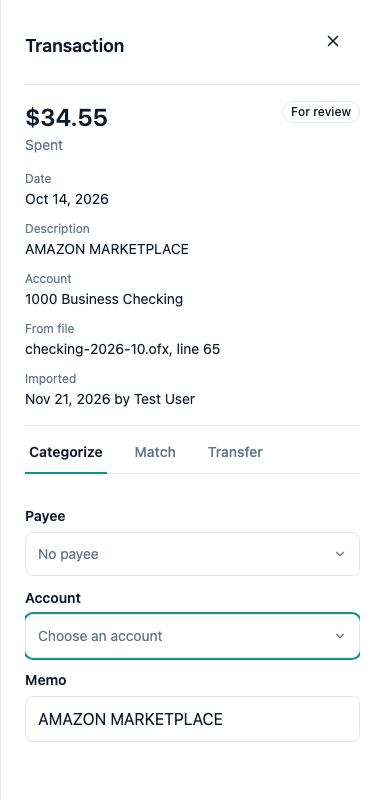
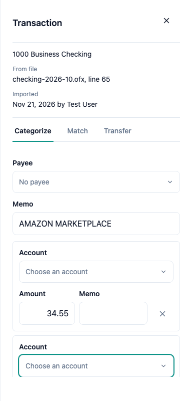
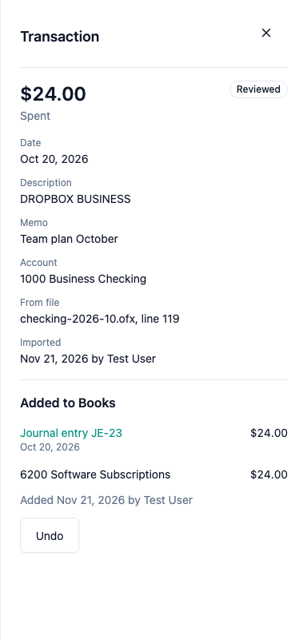

To put a bank transaction into the books, open it on the account's For review tab of the Banking page (see [Review bank transactions](help://books:bank-review)). Under its details, three tabs give the ways to handle it:

- **Categorize** says which account the money belongs to, for example 6400 Office and general. Books posts a new journal entry for it. Use it for money that is not in Books yet. **Split** spreads it over several accounts.
- **Match** links it to a transaction that is already in Books, such as an expense or a bill payment. Nothing new posts. See [Match a bank transaction](help://books:bank-match).
- **Transfer** says the money moved between this account and another bank, credit card or loan account of your books. Books posts a new transfer.

A transaction that Books has a suggestion for opens on Match, which shows the count, for example "Match (1)". A transaction with no suggestion opens on Categorize. You can change the way at any time; the values you typed in the other way are not kept.

When the transaction is in the books, it moves to the Reviewed tab, and the panel shows the next transaction of For review. After the last one, the panel closes.

## Categorize on one account

1. In **Account**, choose the account the money belongs to. Type to search the chart. The list holds every active account but the bank or credit card account itself, Accounts receivable and Accounts payable.
2. In **Payee**, choose the customer or vendor the money came from or went to, or leave No payee.
3. **Memo** starts as the bank's description. Change it when you want another text on the journal entry.
4. Choose **Categorize**.

Books posts a journal entry dated the bank date, with the memo: one line on the bank account for the bank amount, and one line on the account you chose for the same amount on the other side. The payee is on both lines. The line under the toolbar names it, for example "Added Journal entry 1042." The entry has its own number and opens, is edited and is voided as every journal entry. See [Journal entries](help://books:journal-entries).

To record a payment from a customer or to a vendor, do not categorize it to Accounts receivable or Accounts payable: record it with Receive payment or Pay bills, then match the bank transaction to it.

## Split over several accounts

Choose **Split** under the Account field. The account becomes a list of lines, and a second line is added. Each line has its own Account, Amount and an optional Memo. Choose **Add a line** for more lines, up to 50. To remove a line, choose its remove button. When one line is left, the form goes back to one account.

Type each amount without a sign. On money spent, an amount is money spent on that account; on money received, it is money received on that account. A negative amount is the other direction. For example, a deposit of $970.00 can be split into 1,000.00 on Service income and -30.00 on Bank charges and fees: the two lines add up to $970.00. An amount of 0 is not accepted.

Under the lines, the totals line shows what you split against the bank amount, for example "Split $970.00 of $970.00". When they differ, it shows what remains or by how much the lines are over, in red. Categorize is turned on only when every line has an account and an amount and the lines add up to the bank amount.

The journal entry of a split has one line on the bank account for the bank amount, then one line for each split line in order, with its memo.

## Record a transfer

Choose the **Transfer** way. In **To account** (money spent) or **From account** (money received), choose the other account: a bank, credit card or loan account of your books. A line above the fields says what Books will record, for example "A transfer of $500.00 from 1010 Business checking." Choose **Record transfer**. Books posts a transfer dated the bank date, which opens, is edited and is voided as every transfer. See [Transfers](help://books:transfers).

A payment of a credit card from a bank account is a transfer: record it with Transfer, to the credit card account.

When the other account is also connected on the Banking page, its own bank file holds the other side of the movement. Do not record it a second time there: on the other account, that bank transaction shows this transfer as a match suggestion, so match it.

## Categorize many transactions at once

On For review, check the rows of the transactions that go to the same account. Choose **Categorize** in the bar above the list. The dialog shows how many transactions you chose and their money spent and received. Choose the **Account**, and a **Payee** if you want one, then choose Categorize.

Each chosen transaction becomes its own journal entry on that account, with its bank description as the memo. The line under the toolbar says "Categorized 6 transactions." When some could not be categorized, they stay chosen, and the line shows the server's reason when they all have the same one, or how many failed. To split a transaction or record a transfer, open it and use the panel: the dialog has one account for all of them.

## See what was added, and undo it

On the Reviewed tab, the In Books column of an added transaction reads "Added · Journal entry 1042" or "Added · Transfer 1008", a link to the Books transaction. On a phone, the card shows it on its third line.

Press the transaction to open it. The Added to Books section shows the Books transaction as a link, with its date, payee and amount; for a categorized transaction, its lines with their accounts, memos and amounts; and who added it and when, for example "Added Nov 18, 2026 by Ana Ruiz".

To undo it, choose **Undo**. Books voids the journal entry or the transfer: it posts the void reversal and keeps the number. The bank transaction goes back to For review, the panel closes, and the line under the toolbar says, for example, "Undone. Journal entry 1042 is void and the transaction is back in For review." To change an added transaction, undo it and categorize it again, or edit the journal entry or the transfer on its own screen.

When you void or edit the journal entry or the transfer on its own screen (an edit voids the original and posts a correction), the bank transaction goes back to For review. A corrected transaction is then a match suggestion when its amount still fits.

When you disconnect the account, the records of what was added go with its bank transactions. The journal entries and transfers stay posted.

## The close date

Books posts on the bank date. When the bank date is on or before the close date of your Books settings, Categorize, Record transfer and Undo are refused, and the panel shows why. See [Books settings](help://books:settings).

## Who can do what

Everyone with access to Books can see the In Books links on Reviewed and the Added to Books section. With bookkeeper or admin access you can also categorize, split, record transfers, categorize chosen rows and undo. With read-only access there are no ways to choose, no Categorize in the bar and no Undo.

While the server cannot take changes, Categorize, Record transfer, the bar's Categorize and Undo are turned off.

## Keyboard shortcuts

In a web browser or with a hardware keyboard, with bookkeeper or admin access:

| Key | What it does |
| --- | --- |
| `C` | Show the Categorize way and go to its Account, in an open For review transaction. With the panel closed and rows chosen, open the Categorize dialog of the chosen rows. |
| `T` | Show the Transfer way and go to its account |
| ⇧M | Show the Match way |
| ⌘↵ | Categorize or Record transfer, also from a field of the form. In the dialog, Categorize. |
| ⌥↵ | Add a line. The first press is Split. |
| ⌘⌫ | Remove the split line that holds the cursor |
| `Z` | Undo, in an open added transaction on Reviewed |
| Esc | In a field of the form beside the list, leave the field, so the list keys work again. With no field in use, close the panel. |

`C`, `T` and `Z` are text while the cursor is in a text box; ⌘↵, ⌥↵ and ⌘⌫ work there too. When the panel is over the list or a sheet from the bottom, Esc closes it. To see all shortcuts, press ? when the cursor is not in a text box.
