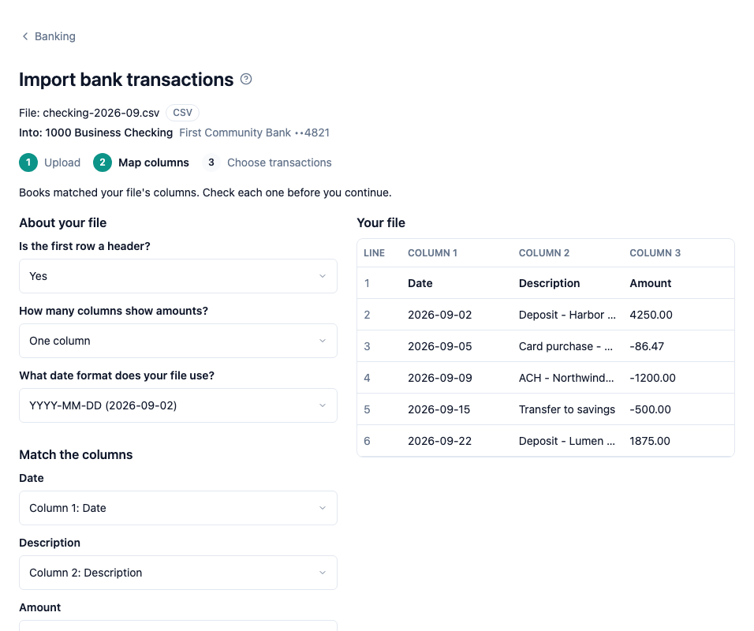

To add the transactions of a statement file to Books, upload the file on the [Banking](help://books:banking) page, then import it. An import adds the rows you choose as bank transactions of the file's account. An import posts nothing to your books: no journal entry, register or report changes.

## Start an import

There are three ways to start:

- After an upload, choose Import transactions beside the "uploaded." line.
- Choose Import on the file's row in the account's file list.
- Press I on the Banking page to import the newest file of the selected account that is waiting to import.

The import page names the file and its format, and the account it goes into. The account is the one you uploaded the file to and cannot change here. To import into another account, upload the file to that account's card.

An OFX, QFX or QBO file goes straight to Choose transactions. A CSV file starts with Map columns.

## Map columns (CSV files)

A CSV file has no fixed layout, so Books asks how yours is laid out. Your file shows its first rows exactly as written, with one column per file column. On a narrow screen, scroll the table sideways to see every column.

Under About your file, answer three questions:

- Is the first row a header? Choose Yes when the first row holds column names, such as Date and Amount.
- How many columns show amounts? Choose One column when one column holds every amount, or Two columns when money in and money out have a column each.
- What date format does your file use? Each choice shows how the first date of your file reads in that format.

Under Match the columns, choose the column of each field: Date, Description, and Amount with Positive amounts are (Money in or Money out), or Money in and Money out for two amount columns.

Books fills in its best guess for each answer. It reads the column names of the first row and the cells under them, and it picks the first date format in which every date of the file reads. When you imported a CSV file into the same account before, Books starts from the columns of that import instead. Check each answer before you continue: a guess can be wrong.

Under the questions, Books shows the first rows as it reads them with your answers. A row that cannot be read shows its error in red, for example a date that is not in the chosen date format. Change an answer and the rows read again at once. Choose Continue when the rows look right.

## Choose transactions

The list shows every row of the file in file order, with its date, description and amount. Money in shows as a plain amount and money out with a minus sign. At the top, Books counts the transactions, and the rows with errors or already imported, and adds up the money in and money out of the rows you chose.

Every row that can be imported is chosen at first. Uncheck a row to leave it out. The box at the top of the list chooses every row that can be imported, or none when all are chosen.

Some rows cannot be chosen:

- A row with an error shows its line number and what is wrong, for example a date Books cannot read. For a CSV file, choose Change mapping (or Back) to change your answers so Books can read it, or import the other rows.
- A row marked Already imported was chosen in an earlier import of this file. Books never adds a row twice.

Choose Import to add the chosen rows. Choose at least one transaction first.

## After the import

Books says how many transactions it added to the account. A transaction that is already in Books, from this file or another file of the same account, is skipped: Books says how many chosen transactions were skipped. On the Banking page the file then shows Imported: and the number of transactions it added.

You can import a file in parts. When rows of the file are still not imported, choose Import more from this file to choose from the rest. You can also open the import again later from the file's row. Imports cannot be undone or changed.

Import each account's statements in one format. A CSV row and an OFX row are the same transaction only when the date, the amount and the description are all the same, so importing the same month once as CSV and once as OFX can add a transaction twice.

## The bank statement balance

An OFX, QFX or QBO statement states the account's balance on the statement date. The account's card on the Banking page shows it under the In Books balance as Bank statement, with the amount and the date, for example "as of Oct 31, 2026". Books uses the file with the latest statement date. A credit card shows what the card owes as a positive amount, as In Books does. A CSV file has no statement balance, so an account with only CSV files shows no Bank statement line.

## Keyboard shortcuts

On the import page:

- ⌘↵: Continue on Map columns, or Import on Choose transactions, also while a choice list has focus
- Esc: go back one step: Back on Choose transactions of a CSV file, otherwise Cancel and return to Banking. With a choice list open, Esc closes the list first.
- A: choose every row that can be imported, or none when all are chosen
- Space or Enter on a focused check box: check or uncheck it

On the Banking page:

- I: Import transactions from the newest file waiting to import

In a web browser on a wide screen, the first question has focus when Map columns opens, and the box at the top of the list has focus when Choose transactions opens.

The keys do nothing while an import runs. To see all shortcuts, press ? when the cursor is not in a text box.

## Who can import

With bookkeeper or admin access you can import transactions. With read-only access you can see the connected accounts and their files, but not the Import buttons, and the import page tells you that you need bookkeeper access.
