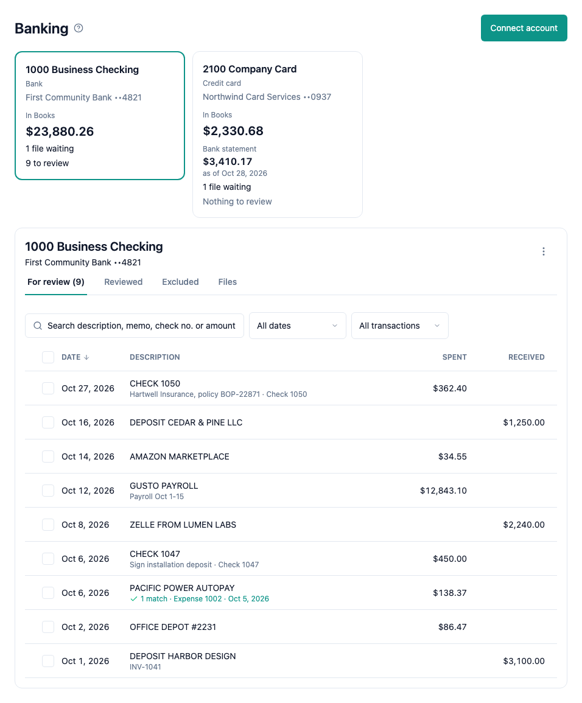
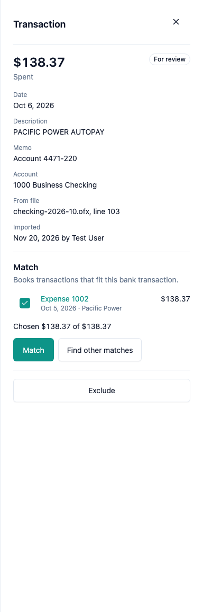

To mark an imported bank transaction as money you already recorded in Books, match it. Open the account's For review tab on the Banking page (see [Review bank transactions](help://books:bank-review)), press the transaction and choose Match in the panel that opens. The transaction moves to the Reviewed tab.

A match only links the bank transaction to one or more Books transactions: a deposit, payment, sales receipt, expense, bill payment, transfer, refund or journal entry that moved the same account. Nothing posts. A match changes no journal entry, register, balance or report.

When the money is not in Books yet, categorize the transaction or record it as a transfer instead: see [Categorize a bank transaction](help://books:bank-categorize).

## How Books finds a match

For each transaction on For review, Books looks for posted Books transactions on the same account that have exactly the same amount, on the same side (money in matches money in), and that are dated from 90 days before to 7 days after the bank date. A void transaction, and a transaction already matched to another bank transaction, is never a suggestion. The nearest date comes first.

On the For review list, a transaction with one suggestion shows a green check and the suggestion under its description, for example "1 match · Transfer 1007 · Sep 3, 2026". A transaction with several suggestions shows a "3 matches" chip with a yellow triangle. A transaction with no suggestion shows its memo as before. On a phone, the card shows the same mark after the day.

## Match one transaction

Press the transaction to open it. Under its details, the Match section lists the suggestions. Each row shows a check box, the type and number of the Books transaction as a link, its amount, its date and the customer or vendor. Press the link to open the Books transaction.

- With one suggestion, its box is already checked. Choose Match.
- With several, none is checked. Check the one that is the same money, then choose Match.

Under the rows, the totals line shows what you chose against the bank amount, for example "Chosen $868.15 of $868.15". Match is turned on only when the chosen transactions add up to the bank amount exactly. When they do not, the line shows the difference in red.

When the match is done, the panel closes and a line under the toolbar says "Matched 1 transaction." The transaction is now on the Reviewed tab.

### Choose several Books transactions

One bank deposit can hold several payments. Check every Books transaction that is part of it. A match holds 1 to 50 Books transactions, and their amounts must add up to the bank amount exactly. When the payments went to Undeposited funds and you recorded the trip to the bank as a [bank deposit](help://books:bank-deposits), the deposit is the one Books transaction that the bank line matches.

## Find other matches

When the suggestions do not hold the right transaction, choose Find other matches. The section lists every Books transaction that can be matched on this account and side, whatever its amount, newest first.

- **From** and **To** set the dates. They start at 90 days before and 7 days after the bank date. From must be on or before To.
- **Search** finds a number, a customer or vendor name, or a memo. Type an amount, such as 86.47, to find transactions of that amount.

Transactions you check stay checked when you change the search or go back to the suggestions. Choose Back to suggestions to return. The totals and Match work as they do in the suggestions.

## Match the chosen rows

To match many transactions at once, check their rows on For review and choose Match in the bar above the list. Books matches each chosen transaction that has exactly one suggestion. A transaction with no suggestion or with several needs a choice: it stays chosen, and the line under the toolbar says so, for example "Matched 4 transactions. 2 need a choice: open them to match." Open each of them to choose its match.

When none of the chosen transactions has exactly one suggestion, the bar's Match is turned off.

## See and undo a match

The Reviewed tab shows what each transaction was matched to in its In Books column, for example "Matched · Transfer 1007" as a link to the Books transaction, or "Matched · 3 transactions" when the match holds several. On a phone, the card shows it on its third line.

Press a matched transaction to open it. The Matched to section lists the matched Books transactions with links, and who matched it and when, for example "Matched Nov 18, 2026 by Ana Ruiz".

To undo the match, choose Undo match. The transaction goes back to For review, and the Books transactions can be matched again. The line under the toolbar says "Match undone. The transaction is back in For review." When the server refuses the undo, the panel stays open and shows why.

## When a matched Books transaction changes

When you void a matched Books transaction, or edit it (an edit voids the original and posts a correction), the match is removed and the bank transaction goes back to For review. A corrected transaction is a suggestion again when its amount still fits.

When you disconnect the account, its matches are removed with its bank transactions.

## Matches and reconciling

When you reconcile the account, a matched Books transaction shows a bank icon in the list, and Clear matched clears every matched transaction at once. In the account register its status is Matched until it is cleared. See [Reconcile an account](help://books:reconcile).

## Who can do what

Everyone with access to Books can see the marks on For review, the suggestions and the Matched to list with their links. With bookkeeper or admin access you can also match, find other matches and undo a match. With read-only access there are no check boxes and no Match, Find other matches or Undo match buttons.

While the server cannot take changes, Match and Undo match are turned off.

## Keyboard shortcuts

In a web browser or with a hardware keyboard, with bookkeeper or admin access:

| Key | What it does |
| --- | --- |
| `M` | Match the chosen Books transactions, in an open For review transaction. With the panel closed and rows chosen, Match the chosen rows. |
| `F` | Find other matches, in an open For review transaction |
| `Z` | Undo match, in an open matched transaction on Reviewed |

While the Match button is turned off, `M` does nothing. To see all shortcuts, press ? when the cursor is not in a text box.
