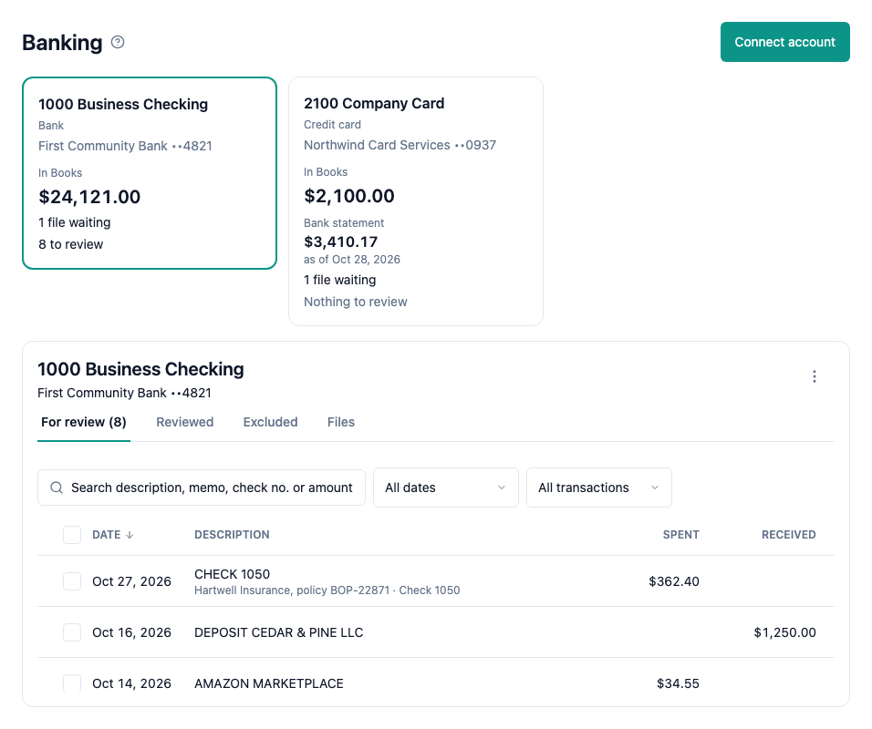

To work through the transactions you imported from a bank file, choose Banking in the sidebar and press the account's card. The account's panel has four tabs. The page opens on For review.

- **For review** holds the imported transactions that are not handled yet. The tab shows how many there are, for example "For review (12)", and the account's card says "12 to review".
- **Reviewed** holds the transactions that were handled by matching or categorizing them.
- **Excluded** holds the transactions you keep out of your books on purpose.
- **Files** holds the upload area and the account's uploaded files. See [Banking](help://books:banking) and [Import bank transactions](help://books:bank-import).

Each list shows the date, the description and the amount. Money out shows under Spent and money in under Received. On a credit card account, a charge is Spent and a payment is Received. Under the description, a row shows its memo and its check number when the bank file has them. On a phone, each transaction is a card with one signed amount: money out has a minus sign.

The newest transactions are first. To see the oldest first, press the Date heading, or Newest first on a phone.

## Find a transaction

Use the toolbar above the list. The search and the filters stay the same when you change the tab or the account.

- **Search** finds the transactions whose description, memo or check number holds every word you type. Type an amount, such as 86.47, $86.47 or 1,250, to find the transactions of that amount, spent or received.
- **Dates** shows All dates, or only This month, Last month, This quarter, This fiscal year or Last fiscal year. The fiscal year starts in the month of your Books settings.
- **Type** shows All transactions, or only Money in or Money out.

To show every transaction again, choose Clear filters. When no transaction matches, the list says "No transactions match these filters." and shows a Clear filters button.

## Open a transaction

Press a row to open the transaction beside the list, or as a sheet from the bottom on a phone. It shows the amount, Spent or Received, its status, and its Date, Description, Memo, Check no., Account, the file and the line it came from, and when and by whom it was imported. Press another row to show that one. To close it, choose the close button or press Esc.

## Exclude a transaction or move it back

To keep a transaction out of your books, open it on For review and choose Exclude. It moves to the Excluded tab. Nothing posts: excluding or moving a transaction back changes no journal entry, register or report.

To undo an exclude, open the transaction on the Excluded tab and choose Move to For review. Excluded is the undo: a transaction is never deleted.

A Reviewed transaction has no action here.

## Choose many transactions

On For review and Excluded, each row has a check box. Check the rows you want, or check the box at the top of the list (Select all on a phone) to select all the transactions the list shows under the current search and filters. Check it again to choose none.

While rows are chosen, a bar replaces the toolbar. It counts the chosen transactions and adds up their money spent and received, for example "3 selected · Spent $412.30 · Received $0.00". Choose Exclude on For review, or Move to For review on Excluded, to change all of them at once. Choose Clear to choose none.

When the change is done, a line under the toolbar says what happened, for example "Excluded 3 transactions." When some transactions could not be changed, they stay chosen, and the line says why. Choose the button again to try again.

## Who can do what

Everyone with access to Books can see the tabs, search, filter and open a transaction. With bookkeeper or admin access you can also choose rows, exclude transactions and move them back. With read-only access there are no check boxes and no Exclude or Move to For review buttons.

While the server cannot take changes, Exclude and Move to For review are turned off.

## Keyboard shortcuts

In a web browser, on For review, Reviewed or Excluded:

| Key | What it does |
| --- | --- |
| ↓ or J | Next transaction. The first press goes to the first row. |
| ↑ or K | Previous transaction |
| X or Space | Choose or unchoose the row (For review and Excluded) |
| ↵ or O | Open the row |
| A | Choose all shown rows, or none when all are chosen (For review and Excluded) |
| E | Exclude the chosen rows, or the open transaction when none is chosen (For review) |
| R | Move the chosen rows, or the open transaction, to For review (Excluded) |
| / | Go to the search (while no rows are chosen) |
| 1, 2, 3, 4 | The For review, Reviewed, Excluded or Files tab |
| Esc | Close the open transaction. With none open, choose none. |

X, Space, A, E and R need bookkeeper access. The keys do nothing while the cursor is in the search: press Esc to leave it. While a change runs, X, Space, A, E and R do nothing. No key works while a menu is open. The page's own keys N, U and I are in [Banking](help://books:banking).

To see all shortcuts, press ? when the cursor is not in a text box.
