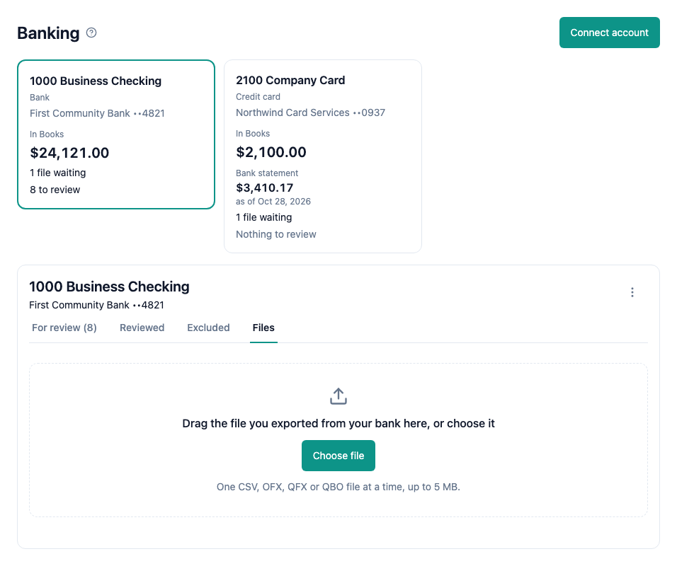

To bring your bank transactions into Books, connect the account and upload the file your bank exports. Each connected account shows as a card at the top of the Banking page, with the number of its transactions to review. Press a card to see its bank details and its four tabs:

- For review, Reviewed and Excluded list the account's imported transactions. See [Review bank transactions](help://books:bank-review).
- The Files tab holds the upload area and the account's uploaded files.

The page opens on For review. To upload or import a file, open the Files tab first.

A sale that a customer pays at once is recorded with a [sales receipt](help://books:sales-receipts), which deposits the money to a bank account or to Undeposited funds.

## Connect an account

To connect an account, choose Banking in the sidebar and choose Connect account. In Account, pick a Bank or Credit card account from your [Chart of Accounts](help://books:chart-of-accounts) that is not connected yet. In a web browser on a wide screen, Account has focus when the dialog opens. Bank name and Last 4 digits are optional. They help you tell your accounts apart. Last 4 digits must be exactly four digits. Choose Connect.

If no account can be connected, the dialog tells you why and links to the Chart of Accounts. Add a Bank or Credit card account there first.

To change the bank name or the last 4 digits later, select the account's card, choose More and choose Edit bank details. On a wide screen, Bank name has focus when the dialog opens. The account of a connection cannot change. To use another account, disconnect this one and connect the other.

## Upload a statement

Sign in to your bank's website and export a statement as a CSV, OFX, QFX or QBO file. Then select the account's card on the Banking page, open the Files tab and choose Choose file. In a web browser you can also drag the file onto the upload area.

Upload one file at a time, up to 5 MB. TXT files are not accepted: if your bank exports a TXT file with comma-separated rows, rename it to end in .csv and upload it again.

The same file cannot be uploaded twice. If you choose a file that is already in Books, Books tells you where it is, for example "oct-2026.csv was already uploaded to 1000 Business Checking on Nov 3, 2026."

Each uploaded file shows in the Files tab's list with its format, size, upload date and the person who uploaded it, and its status: Waiting to import until you import it, then Imported: N transactions, the number of transactions its imports added. To add a file's transactions to Books, see [Import bank transactions](help://books:bank-import).

After an upload, choose Import transactions beside the "uploaded." line to import the new file at once, or choose Import on any file's row later.

## Remove a file

To remove a file, choose Remove on its row, then choose Remove file. The uploaded file is deleted. Nothing in your books changes.

## Disconnect an account

To disconnect an account, select its card, choose More and choose Disconnect. Its files waiting to import are deleted. The account, its balance and its journal entries stay in Books.

While an account is connected, it cannot be made inactive, deleted, or changed to another type in the [Chart of Accounts](help://books:chart-of-accounts). Disconnect it first.

## Keyboard shortcuts

On the Banking page:

- N: Connect account
- U: Choose file for the selected account. U also opens the Files tab, so you see the upload.
- I: Import transactions from the newest file waiting to import
- 1, 2, 3, 4: the For review, Reviewed, Excluded or Files tab, while For review, Reviewed or Excluded shows

The keys of the transaction lists are in [Review bank transactions](help://books:bank-review).

In a dialog:

- ⌘↵: Connect, Save, Remove file or Disconnect, also while the cursor is in a text box
- Esc: close the dialog

N, U and I do nothing while a dialog is open or the cursor is in a text box.

To see all shortcuts, press ? when the cursor is not in a text box.

## Who can do what

With bookkeeper or admin access you can connect accounts, edit bank details, upload, import and remove files, and disconnect accounts. With read-only access you can see the connected accounts, their transactions and their files, and open an account's register with View register.
