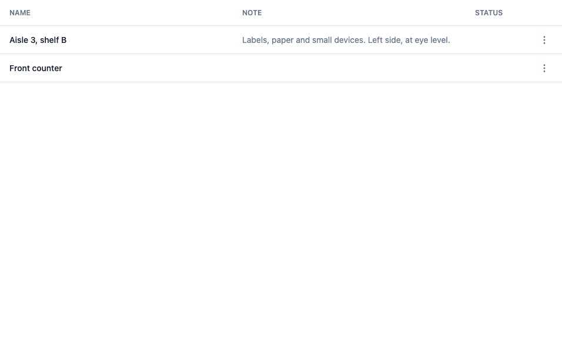

To know where your stock is, create a bin location for each place where you keep it, for example Aisle 3, shelf B. Books then counts the quantity of each Inventory item in each bin location. Stock that is in no bin location is in No bin. A bin location has a quantity and no value: the cost of the stock is the item's (see [Inventory](help://books:inventory)).

## Create a bin location

To see your bin locations, choose Lists in the sidebar, pick the Products and services card, then choose the tab Bin locations. To create one, press New bin location, type a **Name** and, if you want, a **Note**, then press Save. Two bin locations cannot have the same name, and case is ignored: Books refuses it with "A bin location named Aisle 3 exists."

To edit a bin location, press its row, or open its row menu and choose Edit. While the book has no bin location, no other screen shows a bin field or column.

To stop using a bin location, open its row menu and choose Make inactive. An inactive bin location keeps its stock, is not offered in the pickers, and shows with "(inactive)" in the report and on the item page. To see the inactive ones in the list, turn on Show inactive. To use one again, choose Make active.

To delete a bin location, open its row menu and choose Delete. Books refuses to delete a bin location that holds stock or has history (a stock move, an adjustment line, a move between bins, or an item that has it as its default bin): make it inactive instead.

Only a bookkeeper or an admin can create, change or delete bin locations.

## Give an item a default bin

To choose where the stock of an item goes, open the item, choose the Details tab and pick its **Default bin** (under Reorder point), then save. You can pick an active bin location or No bin. Only an Inventory item has a default bin.

## What a sale and a bill do

An invoice, a sales receipt, a bill, an expense, a credit memo, a refund receipt, a vendor credit and the opening stock name no bin location. When one of them posts, Books moves its stock in the item's default bin at that time: a sale takes the stock out of the default bin, and a bill puts it in. When the item has no default bin, the stock moves in No bin. When you void the transaction, Books takes the quantity back from the bin location that it went to.

A change of the default bin moves no stock: it applies to the transactions that you post after it.

## Adjust the stock of a bin

To change the quantity in one bin location, for example after you count a shelf, record an [inventory adjustment](help://books:inventory-adjustments). Each line names its bin: picking the item sets it to the item's default bin, and you can pick another bin location or No bin. On hand shows how many the bin holds.

## Move stock between bins

To move stock from one bin location to another, open the item and press **Move stock** (M). On a phone, Move stock is under More. Pick **From** (each bin location that holds the item, with its quantity, for example "Aisle 3 · 12") and **To**, type the **Quantity** and, if you want, a **Memo**, then press Move stock in the dialog. Books refuses a quantity above what the From bin holds, for example "Aisle 3 holds 12. Move 12 or fewer."

Only a bookkeeper or an admin can move stock. A move is dated now. It changes no cost and no journal entry. A move cannot be changed or deleted: to correct one, move the stock back.

The Bins tab of the item page shows how much each bin location holds, with the mark Default on the item's default bin, and the recent moves between bins.

## See the stock in each bin

To see what each bin location holds, press **Stock by bin** above the bin list. The Stock by Bin Location report opens. To see one bin location only, open its row menu and choose Stock in this bin. For how to read the report, see [Reports](help://books:reports).

The report has one group for each bin location that holds stock, with the items under it as "<code> · <name>", their Quantity and their Reorder point. Use it as the list to count a shelf.
