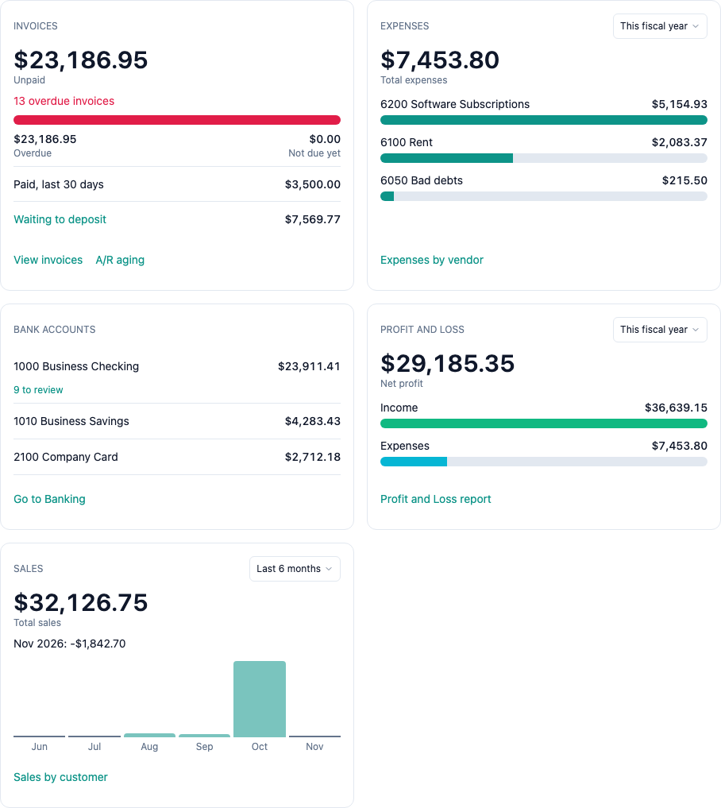

Books opens on the Dashboard the first time you open it. To go back to it, choose Dashboard at the top of the sidebar. The Dashboard shows five widgets: Invoices, Expenses, Bank accounts, Profit and loss and Sales. Every figure is live: when you post, void or pay something anywhere in Books, the Dashboard changes with no reload. For the other ways to move around Books, see [Moving around Books](help://books:navigating-books).

## What each widget counts

**Invoices** shows Unpaid, the open balance of your posted invoices, with one bar split into Overdue (the due date is before today) and Not due yet. Under it, Paid, last 30 days is the total of the payments you received today and in the 29 days before. Waiting to deposit is the balance of your Undeposited funds accounts; it shows only when that balance is not zero.

**Expenses** shows the total of your Cost of goods sold, Expense and Other expense accounts in the period you pick, and the four largest accounts. A sub-account counts toward its top-level account. When more than four accounts have an amount, Everything else adds up the rest.

**Bank accounts** lists your active Bank and Credit card accounts with each one's balance in the books. When a connected account has transactions to review, the row says how many. Press a row to open the account's register, or press the review text to open Banking on that account. The widget shows at most six accounts. When you have more, a last row says how many more (for example "3 more accounts"); press it to open the Chart of Accounts.

**Profit and loss** shows the net profit of the period you pick: Income and Other income minus the Cost of goods sold, Expense and Other expense accounts, on the accrual basis. A line compares it with the same period a year before.

**Sales** shows the Income accounts by month for the period you pick, on the accrual basis. Other income is not sales. To see one month's amount, press or focus its column.

## Pick a period

Expenses and Profit and loss have a period menu with This month, Last month, This quarter, This fiscal year and Last fiscal year. Sales has Last 6 months, Last 12 months and This fiscal year. To change a period, press the menu at the top of the widget and choose one. Books keeps the period you choose.

## Show, hide and reorder widgets

To arrange the widgets, press Customize at the top of the Dashboard (on a phone, the sliders button beside Hide amounts). The widgets turn into a list with one row for each widget, hidden widgets included:

- To change the order, drag a row by its handle, or press Move up or Move down on the row.
- To hide a widget, turn off its Show switch. To show it again, turn the switch on.
- To go back to the first order with all five widgets shown, press Reset to default. It does not change Hide amounts or a widget's period.

Each change is saved at once. When you are done, press Done. If you hide every widget, the Dashboard says so and shows a Customize button.

## Hide amounts

To hide every amount on the Dashboard, for example when others can see your screen, turn on Hide amounts at the top. Amounts and percents draw as dots; counts and account names stay.

Your arrangement is your own: the order, the hidden widgets, Hide amounts and the periods are kept for you and follow you to every device. Other users arrange their own Dashboard.
