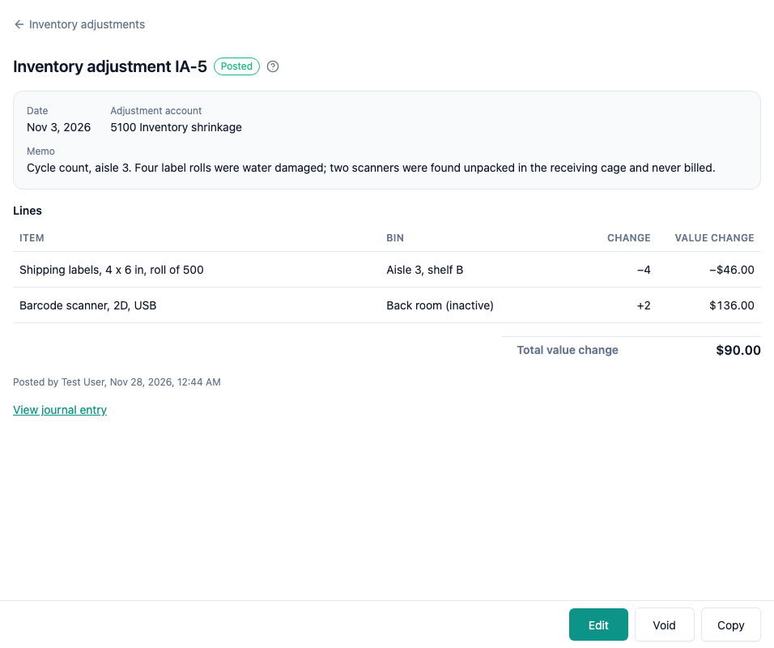

To change how many of an Inventory item you have, or what the stock is worth, record an inventory adjustment. Use one after a stock count, for damaged or lost goods, for stock that you find, or to correct the value of the stock. A purchase or a sale changes the stock by itself: see [Inventory](help://books:inventory).

## Open the inventory adjustments

To see your adjustments, choose Lists in the sidebar, pick the Products and services card, then choose the tab Inventory adjustments. The list shows the date, the number, the items, the account, the value change and the status of each adjustment. The chips All, Draft, Posted and Void keep one status. To find an adjustment, type its number or a word of its memo in the search field. To also see the adjustments that Books made (for the opening stock of an item, or when the cost of a transaction changed), turn on Made by Books.

To open an adjustment, press its row. To start a new one, press New inventory adjustment above the list, or choose New and pick Inventory adjustment. On the page of an Inventory item, Adjust stock (A) starts a new adjustment with one line of that item.

Only a bookkeeper or an admin can record inventory adjustments. Another user sees "You need bookkeeper access to create inventory adjustments".

## Fill in the form

The form New inventory adjustment has these fields:

- **Date**: the day of the change. It starts on today.
- **Adjustment account**: the account for the other side of the change of value, for example Inventory shrinkage. When you leave it empty, Books uses Inventory shrinkage, and creates that account when you post if your chart has none.
- **Memo**: a note for your team.

Each line names one Inventory item. When the book has a bin location, the line also has a **Bin**: picking the item sets it to the item's default bin, and you can pick another bin location or No bin. See [Bin locations](help://books:bin-locations). **On hand** shows how many of the item the bin holds now, with the item's total under it when they differ.

Type the new count in **New quantity**, or the difference in **Change**: Books fills in the other one. When a change takes the quantity below zero, the line shows "Quantity on hand goes below zero." You can still post it.

## Adjust a quantity

To take stock out (damage, loss, a count that is lower), give the line a Change below 0, or type the lower count in New quantity. Value change then shows "At cost": Books takes the cost from the costing method of the book (FIFO or average cost), as a sale does.

## Add stock at a cost

To put stock in, give the line a Change above 0, and type what the added quantity cost in total in **Value change**. When you leave Value change empty, Books uses the last cost that it knows for the item.

## Revalue the stock

To change the value of the stock without changing the quantity, leave Change at 0 and type the change of value in Value change: above 0 to raise the value, below 0 to lower it. The Bin field is off on such a line, because a value change has no bin.

## Record a count of many items

To record a stock count, add a line for each item that you counted and type the counted quantity in New quantity. Press Add line under the lines, or press Enter in the Value change of the last line (in Change when Value change is off), to add the next line. To take a line out, open its menu and choose Remove; Duplicate copies it. An item can be on two lines, for example a decrease and a revaluation. An adjustment has up to 500 lines.

## Post, save a draft or delete a draft

To post the adjustment, press **Post**: the read view opens. **Post & new** posts it and opens a blank form. **Save draft** keeps it without changing the stock; a draft changes nothing until you post it. To delete a saved draft, press **Delete draft** and confirm "Delete this draft inventory adjustment? This can't be undone." On a phone, Save draft, Post & new and Delete draft are under More.

When you post, Books gives the adjustment its number, changes the quantity on hand of each item (in the bin location of the line) and posts the journal entry.

## What Books posts

The journal entry of an adjustment moves the value change between the inventory asset account of each item and the adjustment account. Stock that you take out lowers the inventory asset account at its cost and puts that cost on the adjustment account; stock that you put in, and a revaluation up, raises the inventory asset account. The read view shows the value that Books posted for each line and the **Total value change**, and the link View journal entry. An adjustment that changes no value, such as stock that you find at no cost, has no journal entry, and the read view shows "No journal entry: this adjustment changed no value."

## Correct a posted adjustment

Books never changes a posted adjustment. To correct one, open it and press **Edit**. The form opens with the posted values. When you press Post, Books voids the old adjustment and posts the new one in one step. The old one then shows "Replaced by inventory adjustment" with the number of the new one.

To start a new adjustment from an existing one, press **Copy**: the form opens with its account, memo and lines, dated today.

## Void an adjustment

To take an adjustment back, open it, press **Void** and confirm "Void inventory adjustment <number>? Its stock change is taken back." Books takes the stock change back from each bin location and voids the journal entry. If the date is in a closed period, Books refuses the void and the read view shows why.

Edit, Void and Copy are on an adjustment that a person made only. An adjustment that Books made for the opening stock of an item shows a link to the item: change the item's opening stock instead. An adjustment that Books made when a cost changed shows a link to the transaction.

## Keyboard shortcuts

On the form:

- Post: ⌘↵
- Post & new: ⌘⇧↵
- Save draft: ⌘S
- Cancel: Esc
- Delete draft (a saved draft): ⌘⌫
- Add line: ⌥↵
- Remove line (the line that has the focus): ⌘⌥⌫

In the read view of an adjustment:

- Edit: E
- Void: V
- Copy: C

A key works only while its action is offered. To see the keys of the screen that you are on, press ⇧?.
