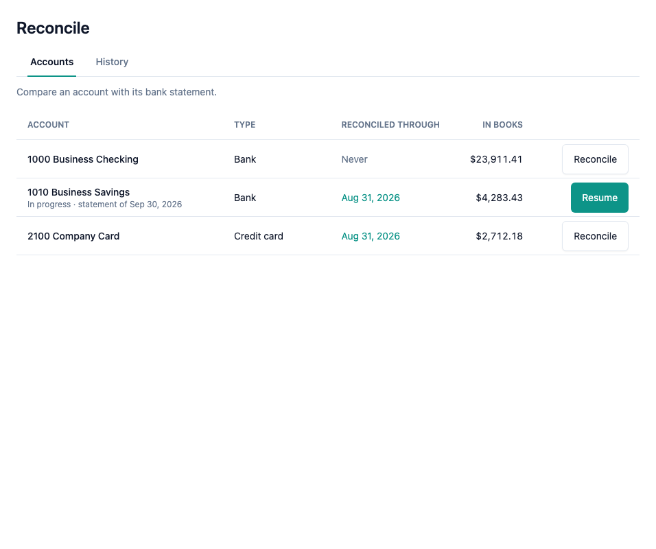
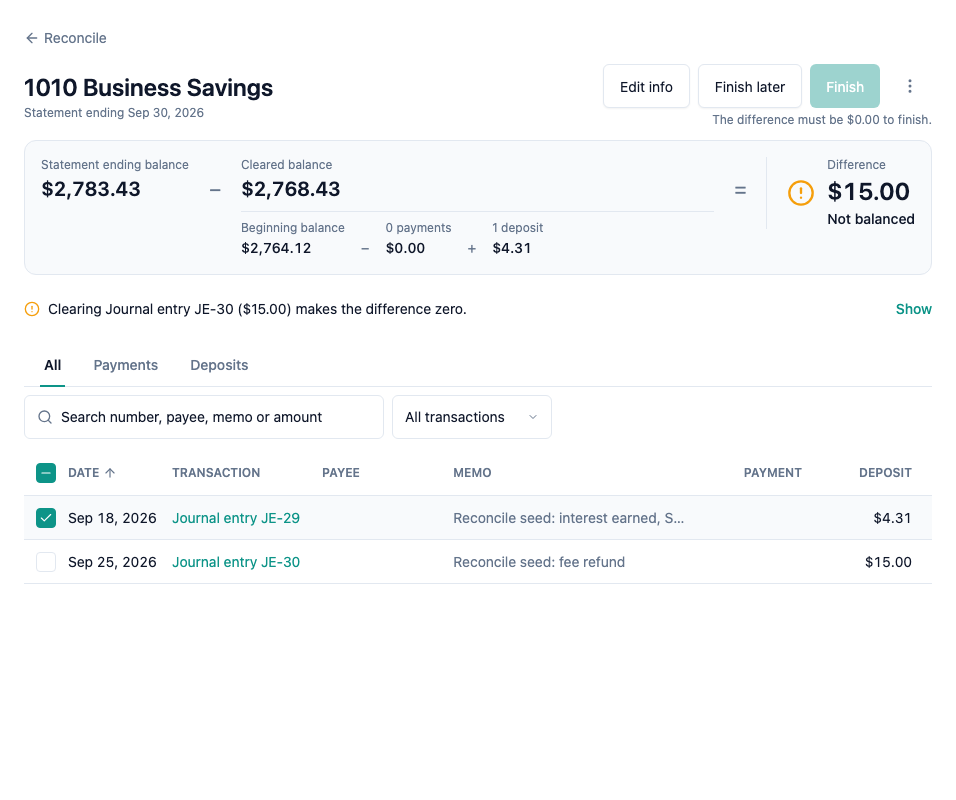
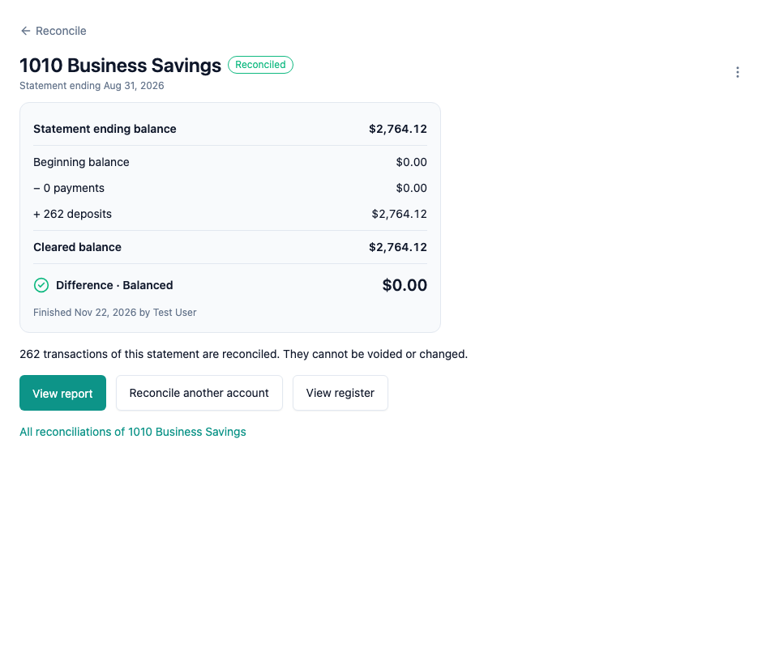
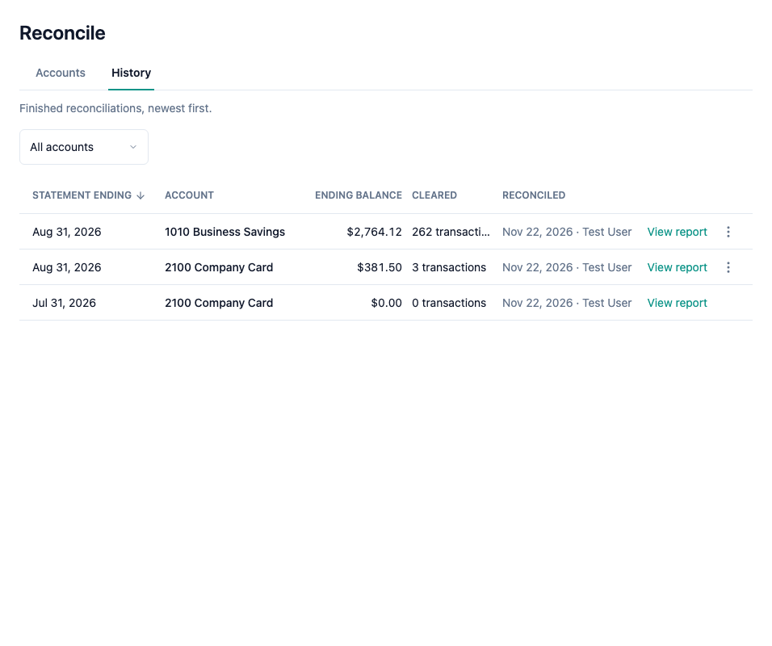
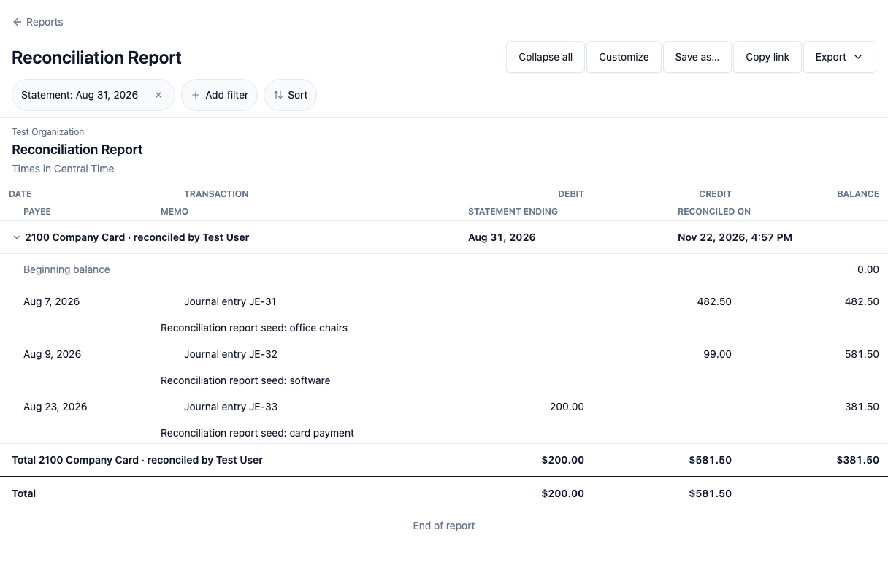
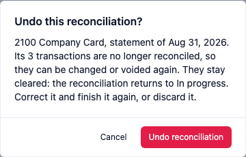

A reconciliation proves that the Books balance of a bank or credit card account agrees with the bank's statement. You type the statement's ending balance and date, mark each Books transaction that is on the statement as cleared, and finish when the difference is $0.00. Nothing posts: a reconciliation changes no journal entry, balance or report.

Every Bank account (Checking, Savings, Money market, Cash on hand or Trust account) and every Credit card account can be reconciled. The account does not need a bank connection.

## Open Reconcile

To open Reconcile, choose Reconcile in the Accounting group of the sidebar. The screen lists each active bank and credit card account, with the date it is reconciled through ("Never" when it has no finished reconciliation) and its balance in Books. Press the date to see that statement's summary.

You can also choose Reconcile at the top of an account's register (see [Account register](help://books:account-register)), or choose More and then Reconcile on the account's card on the Banking page (see [Banking](help://books:banking)).

## Start a reconciliation

To start, choose Reconcile on the account's row. A dialog opens:

- **Beginning balance** is the ending balance of the account's last finished reconciliation. When the account was never reconciled it is $0.00, and its opening balance entry is a transaction to clear.
- **Ending balance** is the balance on the statement. A negative amount is allowed for an overdrawn account. For a credit card account, type the amount owed, for example 864.20.
- **Ending date** is the statement's last day. It must be after the last reconciled statement, and it cannot be after today.
- **Statement totals** are optional. When you type both the Payments and the Deposits of the statement (Charges and Payments for a credit card), Books shows which side is off. Enter both totals, or neither.

When the account's bank connection has an OFX file dated after the last reconciled statement, the dialog starts with that file's balance and date, and says which file they come from. Check them against your statement; you can change both.

Choose Start reconciling. The work screen opens. An account has at most one reconciliation in progress: when it has one, its row shows Resume, and Resume opens it.

## Clear transactions

The list shows every posted transaction on the account dated on or before the statement date that is not reconciled yet. Void entries and their reversals are not in it.

- To clear one transaction, press its row (or its card on a phone). Press it again to unclear it. Each press is saved at once; there is no Save button.
- To clear every transaction the list shows, check the box in the header (Clear all shown on a phone). When all shown rows are cleared, the same box unclears them.
- A transaction matched to an imported bank transaction shows a bank icon. To clear all of them at once, choose Clear matched. See [Match a bank transaction](help://books:bank-match).

To find transactions, choose All, Payments or Deposits, type a number, payee, memo or amount in the search, or choose Not cleared or Cleared in Show. Choose Clear filters to see every transaction again.

## Read the band

The band at the top reads Statement ending balance − Cleared balance = Difference. Under the cleared balance, the second line shows the beginning balance and the sums of the cleared payments and deposits, with their counts. When you entered the statement totals, each side also shows the statement's figure and how much it is under or over. The difference shows Balanced at $0.00 and Not balanced otherwise. On a phone the band is one bar with the difference; press it to see all the balances.

## Use the hints

While the difference is not $0.00, a hint line under the band can tell you where to look. It shows the first hint; "more" at its end shows the others.

- **For review**: bank transactions up to the statement date are still in For review. Choose Open Banking and review them first. See [Review bank transactions](help://books:bank-review).
- **One transaction**: clearing one transaction that is not cleared makes the difference zero. Choose Show to go to it. When several transactions have that amount, Show puts the amount in the search.
- **One cleared transaction**: without one cleared transaction the difference is zero. Check that it is on the statement.
- **Wrong side**: a cleared transaction is half the difference. Check that money out was not entered as money in, or money in as money out.
- **Swapped digits**: the difference divides by 9. Two digits of an amount may be swapped, for example $54.00 entered as $45.00.

At $0.00 the line reads "Balanced. Finish to record this reconciliation."

## Edit info, Finish later and Discard

- **Edit info** changes the statement's ending balance, date and totals. When the new date is earlier, Books unclears the cleared transactions dated after it and says how many.
- **Finish later** returns to Reconcile. Your cleared transactions are already saved; Resume opens them again.
- **Discard reconciliation** (in the More menu) deletes this reconciliation and its cleared marks. No transaction changes.

## Finish

Finish is turned on only at a difference of $0.00. Choose Finish to record the reconciliation. The summary shows the statement and beginning balances, the cleared payments and deposits, and who finished it and when.

A reconciled transaction cannot be voided or changed. Books refuses, for example: "Journal entry 12 is reconciled on 1000 Business Checking (statement of Oct 31, 2026). It cannot be voided or changed." When you void or edit a transaction that is only cleared, its cleared mark is removed, and the correction is a transaction to clear.

A transaction posted later with a date on or before a finished statement is a transaction to clear in the next reconciliation.

## Status words in the register

The account register has a Status column. A transaction reads:

- **Reconciled** when it is in a finished reconciliation,
- **Cleared** when it is cleared in the reconciliation in progress,
- **Matched** when it is matched to a bank transaction and not cleared,
- nothing otherwise.

The register's header shows "Reconciled through" and the date of the last finished statement. The entry drawer shows the same word for this account's line, and "Statement of" and the date for a reconciled line.

## See past reconciliations

To see every finished reconciliation, choose the History tab at the top of Reconcile. The list shows the newest statement first. Each row shows the statement's ending date, the account, the ending balance, the number of cleared transactions, and the day and the person that finished it. On a narrow screen each reconciliation is a card.

- To see only one account, choose it in the Account filter. Choose Clear filter to see all accounts again. "All reconciliations of" the account, under the buttons of a finished summary, opens the History tab with that account chosen.
- To show the oldest statement first, press the Statement ending header. Press it again to show the newest first.
- To open a reconciliation's summary, press its row.

## Open the reconciliation report

The Reconciliation Report is the saved record of a finished reconciliation. To open it, press View report on the row in the History tab (on a card, in its More menu), or press View report on the finished summary.

For each finished reconciliation the report shows the account and who reconciled it, the statement's ending date and when it was reconciled. Under it are the Beginning balance, each cleared transaction with its date, payee, memo, debit, credit and the running balance, and the total, whose balance is the statement's ending balance. Press a transaction's row to open it.

- To see another statement, change the Statement filter. To see the statements of some accounts, use the Account filter. With neither filter set, the report shows every finished reconciliation.
- To print the report or keep a copy, press Export, then Download PDF. Export also gives Excel and CSV files, and the report has Email and Link. See [Run and customize a report](help://books:reports).

## Undo a reconciliation

When a finished reconciliation holds a mistake, a Books admin can undo it. Only a Books admin can undo a reconciliation. Only the latest reconciliation of an account can be undone: to undo an earlier one, undo the later ones first.

To undo, press More on the row in the History tab, or More at the top of the finished summary, then choose Undo reconciliation. A dialog says what the undo does. Choose Undo reconciliation to confirm.

After the undo, the reconciliation is In progress again and its work screen opens. Its transactions are no longer reconciled, so you can change or void them again, but the transactions stay cleared. Correct the reconciliation and finish it again, or discard it. The reconciliation leaves the History tab and the Reconciliation Report until it is finished again.

When the account has another reconciliation in progress, you cannot undo: the dialog names that reconciliation and has Open it. Discard that reconciliation first, then undo.

The Audit Log shows each undo, with the admin who made it and the time. See [Audit log](help://books:audit-log).

## Who can do what

Everyone with access to Books can see Reconcile, the work screen, the summaries, the History tab, the Reconciliation Report and the register's Status words. With bookkeeper or admin access you can also start, clear, edit, finish and discard. Only an admin can undo a reconciliation. With read-only access a row with a reconciliation in progress shows View, the list shows a check mark for a cleared transaction, and there are no boxes and no buttons that change it.

While the server cannot take changes, the boxes, Clear matched, Edit info, Finish, Discard and Undo reconciliation are turned off.

## Keyboard shortcuts

In a web browser or with a hardware keyboard. On the History tab:

| Key | What it does |
| --- | --- |
| ↓ or J, ↑ or K | Move to the next or the previous reconciliation |
| ↵ or O | Open the reconciliation's summary |
| R | Open the reconciliation's report |

On a finished summary:

| Key | What it does |
| --- | --- |
| R | View report |

In the Undo reconciliation dialog:

| Key | What it does |
| --- | --- |
| ⌘↵ | Undo reconciliation |
| Esc | Cancel |

On the Reconcile list:

| Key | What it does |
| --- | --- |
| ↓ or J, ↑ or K | Move to the next or the previous account |
| ↵ | Choose the account's Reconcile, Resume or View |

On the work screen:

| Key | What it does |
| --- | --- |
| ↓ or J, ↑ or K | Move to the next or the previous transaction |
| Space or X | Clear or unclear the transaction |
| ↵ or O | Open the transaction |
| A | Clear all shown transactions, or unclear them when all are cleared |
| M | Clear matched |
| / | Go to the search |
| 1, 2, 3 | All, Payments, Deposits |
| E | Edit info |
| ⌘S | Finish later |
| ⌘↵ | Finish |
| Esc | Clear the search |

In an account's register:

| Key | What it does |
| --- | --- |
| R | Reconcile this account |

To see all shortcuts, press ? when the cursor is not in a text box.
