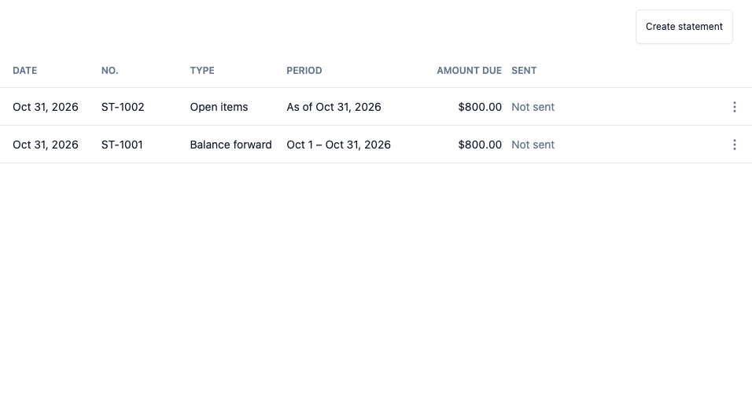

To send statements to your customers, open the New menu and choose **Statement** under Customers, or open a customer's page and choose **New transaction**, then Statement. The Create statements screen opens. Pick the options, check the list of customers, then choose **Save and send**. Each customer gets an email with its statement as a PDF.

## Pick the statement type

- **Balance forward** shows the customer's balance before the period as one line, then each charge, payment and credit of the period with the balance after it, then the amount due on the last day. Use it when the customer pays a running balance and wants to see what changed in the period.
- **Open items** shows each invoice, payment or credit that is still open on the statement date, by due date, then the amount due and an aging line (Current, 1 - 30, 31 - 60, 61 - 90, 91 and over). Use it when the customer pays invoice by invoice and wants to see what is still open and how late it is.

A sub-customer gets its own statement. A parent's statement shows the parent's own lines only.

## Set the dates

**Statement date** prints on the statement and is today at first. For Open items it is the day the open items are read on. For Balance forward, **Start date** and **End date** set the period: at first End date is today and Start date is the same day of the month before. When you change Statement date and have not typed in End date, End date follows it. Start date cannot be after End date, and End date cannot be after Statement date.

## Pick the customers

**Customer balance** decides which customers the list shows:

- **Open** (the default): every customer whose balance is more than zero.
- **Overdue**: every customer with a posted invoice that is open and due before the statement date.
- **All**: every active customer, and every inactive customer whose balance is not zero.

Every customer in the list starts ticked. Choose a row's tick box to leave the customer out, or the tick box in the heading to tick or clear every row (on a phone, **Select all** above the cards). The total at the top adds the balances of the ticked customers. One run holds at most 200 customers; with more, narrow the list with Customer balance. When you open the screen from a customer's page, only that customer is ticked.

## Change an address for one run

The Email address of each row starts with the customer's email address. To send this run's statement to another address, type it in the row. The change applies to this run only: the customer keeps its stored address. To change the customer's address for good, edit the customer.

## Preview, Save and Save and send

- **Preview** (⌥P) shows the statements of the ticked customers as one PDF, each on a new page, and stores nothing. Choose Download in the preview to keep the file.
- **Save** (⌘S) stores one statement for each ticked customer and goes back to the screen you came from. Each statement shows on its customer's Statements tab as "Not sent".
- **Save and send** (⌘↵) stores the statements, then emails each one to the address of its row. Every ticked row needs an address; clear the tick of a customer that has none.
- **Cancel** (Esc) leaves the screen. If you changed an option, a tick or an address, Books asks before it discards the changes.

On a phone, the bar holds Save and send, and **More** holds Preview, Save and Cancel.

If the server cannot send email, Save and send is disabled and the line "Email sending is not set up" shows under the bar. Save and Preview still work.

## When a send fails

Books stores all the statements first and then sends them. When the email server does not answer, Books tries the delivery of that statement again a few times before it gives up. An address that the email server refuses is not tried again.

If a statement cannot be stored or sent, the screen stays open, and a notice above the list says how many statements were sent (or saved) and names each customer that failed with the reason. The rows that succeeded lose their tick. A row whose statement was stored but not sent stays ticked, and a line under its address gives the statement number and the reason, for example "ST-1003 not sent: The email could not be sent. Try again."

Choose Save and send again to try only the failed rows. For a row with a stored statement, Books sends the same saved statement to the address now in the row, so correct the address first if the email server refused it. Books stores no new statement for that row, and the statement takes no new number. A customer whose statement could not be stored has no statement yet, so Save and send stores it again.

If you close the screen, a statement that was stored but not sent stays on its customer's Statements tab as "Not sent". Open it and choose Send… to send it.

## What the email says

The subject is "Statement" with the statement number and your business name, for example "Statement ST-1001 from Aspen Ridge Landscaping". The message greets the customer and gives the statement date and the figures of the statement:

- For Open items: the amount due, how much is past due with the oldest due date (or "Nothing is past due."), and the number of open items.
- For Balance forward: the period, the balance forward, the new charges, the payments and credits, and the amount due.

When nothing is due, or the customer has a credit, the message says that no payment is due. The PDF of the statement is attached. To pay or ask a question, the customer replies to the email, which goes to the address of the user who sent it; when your business phone is set in Settings, the message also gives it.

## Statement numbers

Each saved statement gets a number, such as ST-1001, from its own sequence. A statement takes its number when it is saved; a preview has none. To change the prefix or the next number, open Settings → Numbering and use the **Statements** card. Deleting a statement does not free its number.

## Find, send again and delete a statement

A customer's statements are on the **Statements** tab of the customer's page (⌥5), newest first, with the date, the number, the type, the period, the amount due and when and where each one was sent. Choose a row to open the statement: the screen shows the statement's PDF under its title.

- To send a statement again, choose **Send…** or press `S`. Check the address in To, then choose Send or press ⌘↵. The Sent line then shows the latest send. Esc closes the dialog without sending.
- To keep a copy, choose **Download PDF** or press `D`.
- To delete a statement, choose **More**, then **Delete**, and confirm. A sent statement can be deleted too. Deleting a statement does not change what the customer owes.
- Press Esc to go back to where you came from.

The row menu of each statement on the tab holds the same Open, Send…, Download PDF and Delete. When the server cannot send email, the row menu has no Send…, and on a statement Send… is disabled with the line "Email sending is not set up".

## Why the amount due can differ later

Each time you open a statement, Books builds its PDF from the ledger as it is now, for the statement's dates. If someone later posts or voids a transaction dated in that period, the PDF changes. The Amount due on the Statements tab is the figure from when the statement was made; when the two differ, the statement screen shows "The amount due was … when this statement was made."

## Who can make statements

Making, sending and deleting statements needs Books write access (a bookkeeper or an admin). A user with read-only access sees the Statements tab, opens a statement and downloads its PDF, but sees no Statement item in the New menu, no Create statement button, and no Send… or Delete.

## Reports

The figures of each statement come from two Books reports, **Statement: Balance Forward** and **Statement: Open Items**, in the Reports hub. See [Reports](help://books:reports).

## Keys

- On Create statements: ⌥P Preview, ⌘S Save, ⌘↵ Save and send, Esc Cancel.
- On a statement: `S` Send…, `D` Download PDF, Esc Back.
- In Send statement: ⌘↵ Send, Esc Cancel.
- On a customer's page: ⌥5 selects the Statements tab.
